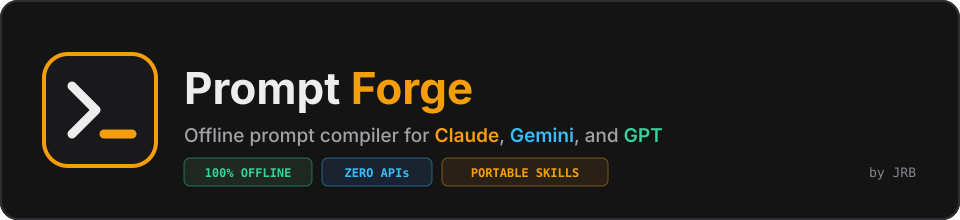

<p align="center">
  
</p>

<p align="center">
  <a href="https://nefariouskindqt.github.io/prompt-forge/"></a>
  
  
  
  <a href="./TERMS.md"></a>
</p>

---

**Prompt Forge** turns any rough idea—software, AI video/image apps, UI/UX, security audits, writing, strategy, automation, or research—into a token-efficient, phased, source-verified prompt tuned for **Claude**, **Gemini**, and **GPT**.

Everything compiles deterministically **inside your browser or local CLI**. There are **no APIs**, **no API keys**, **no accounts**, **no analytics**, and **no location or device tracking**.

## Try It Live

Open the deployed web app directly in your browser:

- **Web App**: [https://nefariouskindqt.github.io/prompt-forge/](https://nefariouskindqt.github.io/prompt-forge/)

---

## How to Use (3 Steps)

1. **Describe your idea** in the **Goal** box (or click a starter example).
2. **Choose your workspace, model, and token budget**:
   - **Workspace**: `Antigravity`, `IDE` (Cursor, Claude Code, Codex, Windsurf), `Chat` (Claude.ai, ChatGPT, Gemini web), or `API` (reusable system prompt).
   - **Model**: Pick from Claude, Gemini, or GPT—Prompt Forge automatically switches formatting, rules, and visual accents to match.
   - **Budget**: `Lean`, `Standard`, or `Thorough` with live side-by-side token estimates.
3. **Review and copy**:
   - Answer any clarifying questions in the **Questions** tab to fold facts straight into context.
   - Inspect the **Phases** and **Skills** tabs (portable approach skills work in **every** workspace, including Chat).
   - Click **Copy prompt** (`Ctrl+Shift+C`) or download as `.md`.

---

## Supported Models

| Family | Models | Prompt Structure | Color Accent |
| :--- | :--- | :--- | :--- |
| **Claude** | Opus, Sonnet, Haiku, **Fable** | XML-tagged sections (`<context>`, `<goal>`, `<phases>`, `<skills>`) | Warm Amber |
| **Gemini** | 4 Carbon, 4 Neon, 4 Argon, 4 Hydrogen, 3.5 Flash-Lite | Markdown headings with `## Task` anchored last | Sky Cobalt |
| **GPT / OpenAI** | **GPT-5**, **GPT-5 mini**, **GPT-4.1**, **OpenAI o3** | Markdown headings with `## Goal` placed up front | Crisp Emerald |

---

## Built-In Quality Modules

Toggle any module on or off to fit your token budget:

- **Save tokens**: Brief replies, changed diffs only for code, zero filler.
- **Unslop and verify**: Code hygiene + test/lint checks (or crisp draft review for non-code ideas).
- **Ask first**: High-impact clarifying questions before acting, then wait.
- **Model tuning**: Native formatting and rules for Claude, Gemini, or GPT.
- **Security**: Boundary input validation, server-side secrets, authz, OWASP checks.
- **Senior UI/UX**: Design tokens, all UI states, WCAG 2.2 AA, anti-slop rules (auto-omitted for non-UI tasks).
- **Phased plan**: Ordered phases with explicit exit gates (and an automatic **Verify sources** phase whenever source checking is requested).
- **Grounding**: Evidence per phase and primary-source verification to curb hallucinations.
- **Use skills**: Portable approach skills embedded in **every** workspace (Chat, IDE, API, Antigravity), plus workspace-specific tools where supported.

---

## Run Locally

Requires **Node.js 20+**.

```bash
git clone https://github.com/nefariouskindqt/prompt-forge.git
cd prompt-forge/app
npm install
npm run dev
```

### Build & Test

```bash
cd app
npm test          # Run the 36 unit tests
npm run build     # Typecheck + production build with strict offline CSP
npm run build:cli # Rebuild the standalone Node CLI (plugin/skills/prompt/scripts/forge.mjs)
```

### Standalone Offline CLI

```bash
node plugin/skills/prompt/scripts/forge.mjs \
  --goal "Create a web app that makes AI videos and images and verify all sources" \
  --model claude-fable \
  --target chat \
  --budget standard
```

---

## Security & Privacy Guarantees

- **Zero APIs**: No external AI SDKs, no network fetches, and no backend servers.
- **Strict Content Security Policy**: Production builds ship with `connect-src 'none'`, `script-src 'self'`, `style-src 'self'`, `object-src 'none'`, and `referrer: no-referrer`.
- **Zero Tracking**: No analytics, no cookies, no IP/location lookup, and zero personal data collection. Only your chosen light/dark theme is saved in browser `localStorage`.

---

## Terms of Service & Copyright

By using Prompt Forge, you agree to the [Terms of Service](./TERMS.md).

© 2026 **JRB** ([github.com/nefariouskindqt](https://github.com/nefariouskindqt)). All rights reserved. See [LICENSE](./LICENSE).
